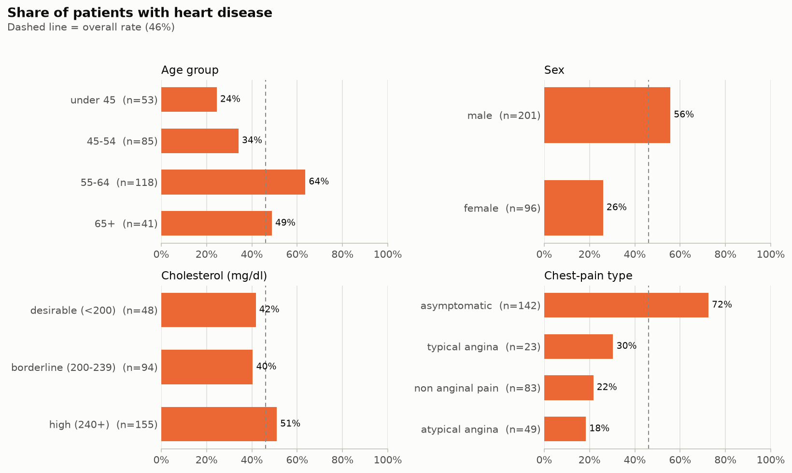
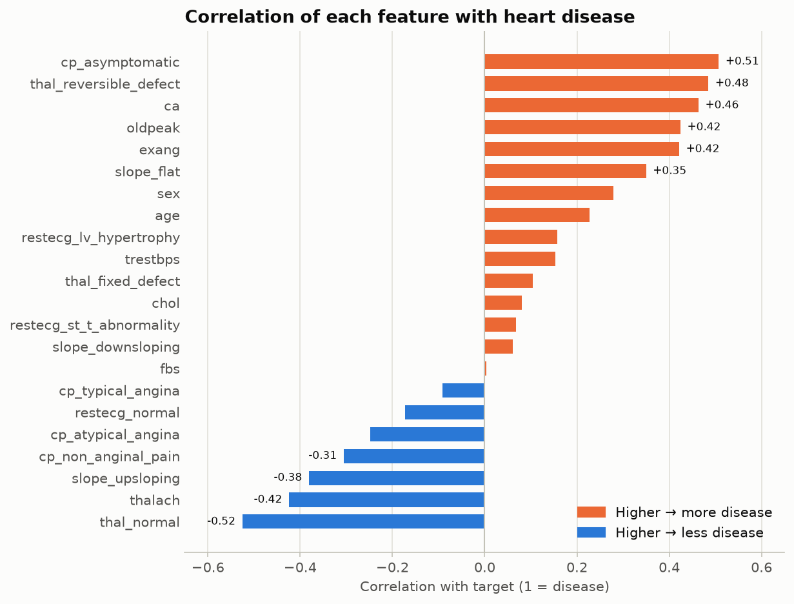

# Heart Disease Prediction

An interpretable machine-learning project that predicts heart-disease risk from clinical indicators.

## Problem

Heart-disease risk is often spotted late, and black-box models are hard for clinicians to trust.

## Solution

An interpretable model that predicts the presence of heart disease from routine clinical measurements (age, blood pressure, cholesterol, max heart rate, ECG and stress-test results), with clear explanations of which features drive each prediction.

## Planned features

- [x] Project setup and data dictionary *(Week 1)*
- [x] Initial data audit: shape, types, missing values, duplicates *(Week 1)*
- [x] Data cleaning: missing values, types, one-hot encoding *(Week 2)*
- [x] SQLite database with a normalized schema (`heart.db`) *(Week 2)*
- [x] SQL analysis queries on the SQLite database *(Week 3)*
- [x] Exploratory data analysis and charts with Matplotlib *(Week 3)*
- [ ] Baseline models with accuracy, recall and ROC-AUC
- [ ] Feature-importance charts
- [ ] Simple results dashboard

## Key insights (EDA)

From the SQL queries in [`sql/analysis.sql`](sql/analysis.sql) and the charts in [`notebooks/03_eda.ipynb`](notebooks/03_eda.ipynb), on 297 patients (46% with heart disease):

1. **"Asymptomatic" chest pain is the strongest single signal.** 72.5% of asymptomatic patients have disease, vs. 18–30% for the three types of chest pain. It holds for men (79%) and women (55%). Everyone in this dataset was referred for angiography, so "asymptomatic" means silent disease found for another reason.
2. **Exercise-test results separate the groups clearly.** Patients with disease reach a lower max heart rate (139 vs. 159 bpm), show more ST depression (1.59 vs. 0.60 mm) and get exercise-induced angina far more often (54% vs. 14%).
3. **Risk climbs with each blocked vessel.** 26% of patients with 0 vessels colored on fluoroscopy have disease, rising to 68%, 82% and 85% for 1, 2 and 3 vessels.
4. **Men and patients aged 55–64 carry more risk.** 56% of men vs. 26% of women; 24% under 45 vs. 64% at 55–64.
5. **Cholesterol is a weak signal on its own.** 42% / 40% / 51% for desirable / borderline / high cholesterol (correlation with disease: +0.08).

These are one-feature-at-a-time views of a small hospital cohort, not the general population; the models will test which signals hold up together.





More charts (target balance, distributions, correlation heatmap) are in [`reports/figures/`](reports/figures/).

## Dataset

[UCI Heart Disease, Cleveland subset](https://archive.ics.uci.edu/dataset/45/heart+disease): 303 patients, 13 clinical features, plus a diagnosis column. See [`data/DATA_DICTIONARY.md`](data/DATA_DICTIONARY.md) for every column.

## Project structure

```
heart-disease-prediction/
├── data/
│   ├── raw/               # original, untouched data
│   ├── processed/         # cleaned CSVs + heart.db (generated, not committed)
│   └── DATA_DICTIONARY.md
├── notebooks/
│   ├── 01_data_overview.ipynb
│   ├── 02_data_cleaning.ipynb
│   └── 03_eda.ipynb       # SQL results + charts
├── sql/
│   ├── schema.sql         # SQLite table schema
│   └── analysis.sql       # exploratory queries
├── src/
│   ├── data_loading.py    # reusable loading helpers
│   ├── cleaning.py        # clean + encode -> data/processed/*.csv
│   ├── database.py        # load cleaned data into heart.db
│   └── queries.py         # run named queries from analysis.sql
├── reports/figures/       # EDA charts (PNG)
├── requirements.txt
└── README.md
```

## Getting started

```bash
git clone https://github.com/ciellamher/heart-disease-prediction.git
cd heart-disease-prediction
python3 -m venv .venv
source .venv/bin/activate
pip install -r requirements.txt

# Build the cleaned data and the SQLite database
python -m src.cleaning
python -m src.database

jupyter notebook notebooks/
```

## Tools

Python · pandas · SQL / SQLite · scikit-learn · Matplotlib · Git

## Dataset citation

Janosi, A., Steinbrunn, W., Pfisterer, M., & Detrano, R. (1989). *Heart Disease* [Dataset]. UCI Machine Learning Repository. https://doi.org/10.24432/C52P4X (CC BY 4.0)
