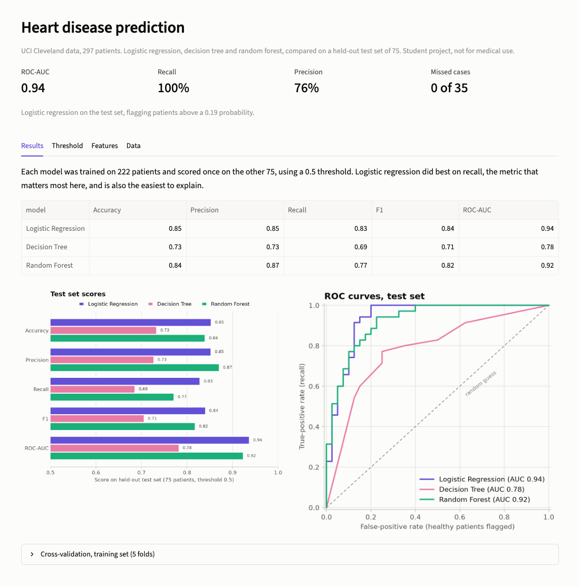
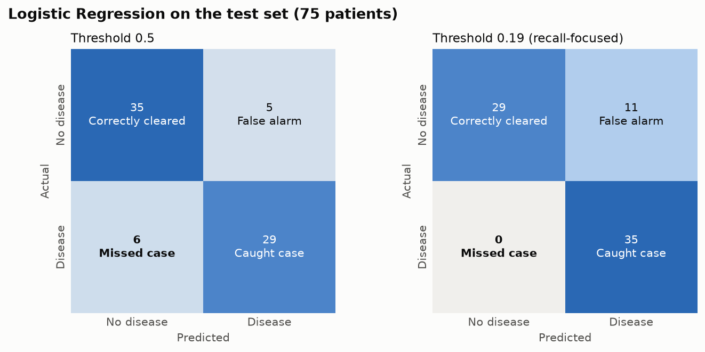
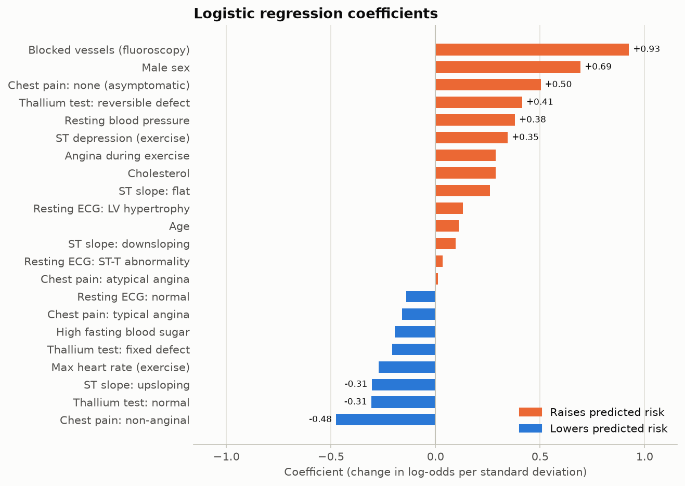
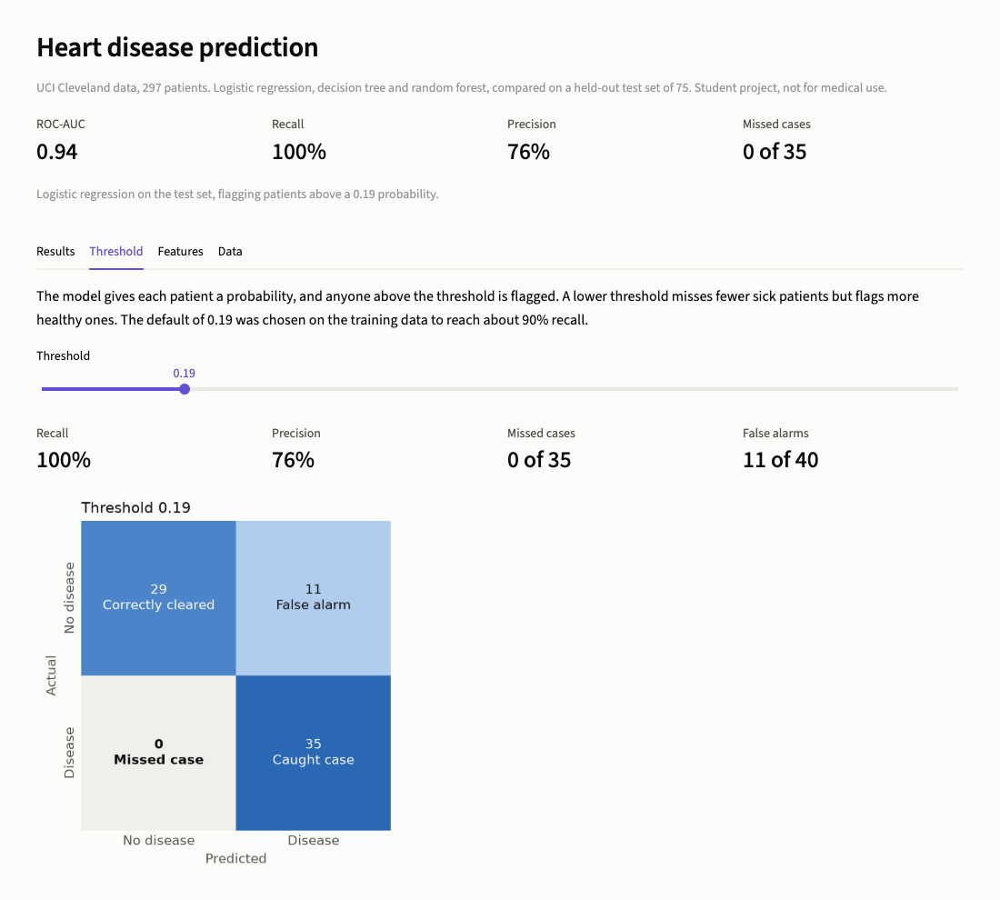
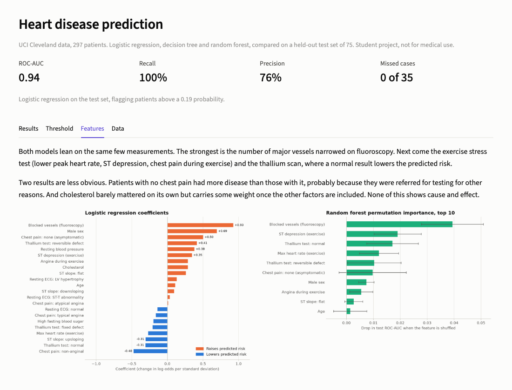

# Heart Disease Prediction

An interpretable machine-learning project that predicts heart disease from routine clinical measurements, and explains which factors drive each prediction.

**Status: Finished** (November 2026) · Python · pandas · SQL / SQLite · scikit-learn · Matplotlib · Streamlit

> **Not medical advice.** This is a learning project on a small, decades-old hospital dataset. The models are not validated for clinical use and must not be used to diagnose anyone.



## Problem

Heart disease is often spotted late. Machine-learning models can flag at-risk patients from routine test results, but black-box models are hard for clinicians to trust. This project asks two questions:

1. How well can simple, explainable models detect heart disease from 13 standard clinical measurements?
2. Which measurements drive the prediction, in terms a non-specialist can follow?

Because missing a sick patient is far worse than a false alarm, **recall** (the share of sick patients the model catches) is the main metric.

## Data

[UCI Heart Disease, Cleveland subset](https://archive.ics.uci.edu/dataset/45/heart+disease): 303 Cleveland Clinic patients who underwent coronary angiography. 13 features cover age, sex, chest-pain type, blood pressure, cholesterol, ECG, exercise stress test, fluoroscopy and thallium scan results. The target is whether angiography found > 50% narrowing in any major vessel. Every column is described in [`data/DATA_DICTIONARY.md`](data/DATA_DICTIONARY.md).

After cleaning: **297 patients, 46% with heart disease** (6 rows with missing test results dropped).

## Approach

| Step | What | Where |
|---|---|---|
| 1. Audit | Shape, types, missing values, duplicates | [`01_data_overview.ipynb`](notebooks/01_data_overview.ipynb) |
| 2. Clean & encode | Drop 6 incomplete rows, fix types, validate every code, one-hot encode chest pain / ECG / slope / thallium | [`src/cleaning.py`](src/cleaning.py), [`02_data_cleaning.ipynb`](notebooks/02_data_cleaning.ipynb) |
| 3. Store | SQLite database with primary/foreign keys, CHECK constraints, lookup tables and a labelled view | [`sql/schema.sql`](sql/schema.sql), [`src/database.py`](src/database.py) |
| 4. Explore | 8 SQL queries (risk by age, sex, cholesterol, chest pain…) and 5 Matplotlib charts | [`sql/analysis.sql`](sql/analysis.sql), [`03_eda.ipynb`](notebooks/03_eda.ipynb) |
| 5. Model | Logistic Regression, Decision Tree, Random Forest. Stratified 75/25 split, 5-fold CV on training data, test set used once | [`src/modeling.py`](src/modeling.py), [`04_modeling.ipynb`](notebooks/04_modeling.ipynb) |
| 6. Tune for recall | Lower the decision threshold until out-of-fold recall on the **training** set reaches 90% | [`src/modeling.py`](src/modeling.py) |
| 7. Explain & present | Logistic coefficients, Random Forest permutation importance, Streamlit dashboard | [`src/plots.py`](src/plots.py), [`app.py`](app.py) |

## Results

**Held-out test set** (75 patients, default threshold 0.5):

| Model | Accuracy | Precision | Recall | F1 | ROC-AUC |
|---|---|---|---|---|---|
| **Logistic Regression** | **0.85** | 0.85 | **0.83** | **0.84** | **0.94** |
| Decision Tree | 0.73 | 0.73 | 0.69 | 0.71 | 0.78 |
| Random Forest | 0.84 | **0.87** | 0.77 | 0.82 | 0.92 |

**5-fold cross-validation** on the 222 training patients (mean):

| Model | Accuracy | Precision | Recall | F1 | ROC-AUC |
|---|---|---|---|---|---|
| Logistic Regression | 0.82 | 0.82 | 0.79 | 0.80 | 0.88 |
| Decision Tree | 0.78 | 0.78 | 0.76 | 0.76 | 0.86 |
| Random Forest | 0.82 | 0.81 | 0.77 | 0.79 | 0.92 |

**Logistic Regression is the chosen model.** It has the best recall and F1 in cross-validation and on the test set, and it's the easiest to explain. The Random Forest ranks patients slightly better in cross-validation (ROC-AUC 0.92 vs. 0.88) but catches fewer cases at the default threshold.

**Recall-focused threshold.** Flagging patients at a predicted probability of **0.19** instead of 0.5 (chosen on training data only) caught **all 35** sick patients in the test set. The cost: 11 of 40 healthy patients flagged for follow-up instead of 5. A perfect score on 35 cases is partly luck; about 90% recall, the cross-validation target, is the realistic expectation.



## What drives the prediction



Both models agree on the top factors:

1. **Blocked vessels on fluoroscopy.** The more major vessels that show narrowing on the dye X-ray test, the higher the risk. This is the strongest factor in both models.
2. **Exercise stress test.** A low max heart rate, ST depression (a dip in the ECG trace during exercise) and chest pain brought on by exercise all point to a heart that struggles under load.
3. **Thallium scan.** A normal scan lowers risk. A *reversible defect*, where blood flow drops during exercise and recovers at rest, raises it.
4. **No chest pain ("asymptomatic").** Counter-intuitively, patients with no chest pain had *more* disease (72.5% vs. 18–30% for the three types of chest pain). They were referred for testing anyway, so this often means silent disease.
5. **Male sex.** 56% of men vs. 26% of women had disease.

Cholesterol looked weak on its own in the EDA (42% / 40% / 51% disease across the desirable / borderline / high bands), but gets a moderate positive weight once other factors are accounted for. These are associations in one hospital's data, not causes. Random Forest permutation importance and the full EDA are in [`reports/figures/`](reports/figures/).

## Dashboard

`streamlit run app.py` opens a dashboard with four tabs: model results, a threshold slider showing missed cases against false alarms, feature importance, and the data summary.

| Threshold | Features |
|---|---|
|  |  |

## How to run

```bash
git clone https://github.com/ciellamher/heart-disease-prediction.git
cd heart-disease-prediction
python3 -m venv .venv
source .venv/bin/activate
pip install -r requirements.txt

python -m src.cleaning     # cleaned CSVs -> data/processed/
python -m src.database     # SQLite database -> data/processed/heart.db
python -m src.modeling     # train + evaluate, metrics -> reports/
streamlit run app.py       # dashboard at http://localhost:8501

jupyter notebook notebooks/   # step-by-step notebooks 01-04
```

The dashboard and `src.modeling` build everything from the raw file, so they also work without the first two commands.

## Limitations

- **Not medical advice.** Not validated for clinical use.
- **Small, old, single-site data.** 297 patients from one US hospital, published in 1988. Results may not carry over to other hospitals, populations or today's testing practices.
- **Referred patients only.** Everyone here was already sent for angiography, so the disease rate (46%) is far above the general population's. This also explains the "asymptomatic" finding.
- **Some features come from invasive or specialist tests** (fluoroscopy, thallium scan). A model meant for early screening would need to work without them.
- **Small test set.** 75 patients (35 with disease), so each test metric has wide uncertainty. Cross-validation scores are reported alongside for that reason.
- **Associations, not causes.** Feature importance shows what the model uses, not what causes heart disease.
- **Sex imbalance.** Two-thirds of the patients are male, so the model has seen fewer women.

## Project structure

```
heart-disease-prediction/
├── app.py                 # Streamlit dashboard
├── data/
│   ├── raw/               # original, untouched data
│   ├── processed/         # cleaned CSVs + heart.db (generated, not committed)
│   └── DATA_DICTIONARY.md
├── notebooks/
│   ├── 01_data_overview.ipynb
│   ├── 02_data_cleaning.ipynb
│   ├── 03_eda.ipynb       # SQL results + EDA charts
│   └── 04_modeling.ipynb  # models, threshold, feature importance
├── sql/
│   ├── schema.sql         # SQLite table schema
│   └── analysis.sql       # exploratory queries
├── src/
│   ├── data_loading.py    # load the raw file
│   ├── cleaning.py        # clean + encode
│   ├── database.py        # build heart.db
│   ├── queries.py         # run named queries from analysis.sql
│   ├── modeling.py        # train, evaluate, tune threshold, importance
│   └── plots.py           # shared chart style and model charts
├── reports/
│   ├── figures/           # EDA and model charts (PNG)
│   ├── screenshots/       # dashboard screenshots
│   └── metrics_*.csv      # cross-validation and test metrics
├── requirements.txt
└── README.md
```

## Dataset citation

Janosi, A., Steinbrunn, W., Pfisterer, M., & Detrano, R. (1989). *Heart Disease* [Dataset]. UCI Machine Learning Repository. https://doi.org/10.24432/C52P4X (CC BY 4.0)
